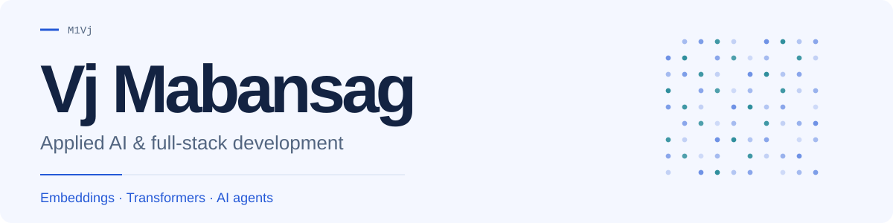

<picture>
  <source media="(max-width: 600px) and (prefers-color-scheme: dark)" srcset="./assets/hero-dark-mobile-still.svg">
  <source media="(max-width: 600px)" srcset="./assets/hero-light-mobile-still.svg">
  <source media="(prefers-color-scheme: dark)" srcset="./assets/hero-dark-still.svg">
  
</picture>

**Building useful AI tools.**

<picture>
  <source media="(max-width: 600px) and (prefers-color-scheme: dark)" srcset="./assets/stats-dark-mobile.svg">
  <source media="(max-width: 600px)" srcset="./assets/stats-light-mobile.svg">
  <source media="(prefers-color-scheme: dark)" srcset="./assets/stats-dark.svg">
  
</picture>

Public GitHub snapshot · 2026-10-25

<b>Projects</b> — AI tools &amp; full-stack builds

- **[HydraLab](https://github.com/M1Vj/HydraLab)** — My local research workbench for reading, citations, writing and research agents. Pre-release.
- **[VSU SmartMap](https://github.com/M1Vj/VSU-SmartMap)** — Campus navigation with Gemini-powered location chat. Started as a group project; now maintained solo. [Open map](https://vsumap.vercel.app/).
- **[MathWiz Arena / centipede](https://github.com/M1Vj/centipede)** — Lead developer on a collaborative math competition platform.
- **[Dormy](https://github.com/M1Vj/Dormy)** — My solo-built dormitory operations app. **UniDorm is a separate group project.**
- **[CodexSwap](https://github.com/M1Vj/CodexSwap)** — Native macOS tooling. **[VSUEE skill](https://github.com/M1Vj/vsuee-skill)** — E-learning automation for AI agents.

<b>Research</b> — embeddings, transformers &amp; evaluation

My undergraduate research compares passive AI-text detector scores on paired watermarked and unwatermarked Gemma responses, using Python analysis and reproducibility checks.

I focus on **embeddings, transformers, NLP, AI agents and evaluation**. Detector scores require careful interpretation.

<b>Toolbox</b> — Python, TypeScript &amp; beyond

**Python · TypeScript · React / Next.js · FastAPI · PostgreSQL / Supabase · Git**

<b>About</b> — background &amp; opportunities

I'm a **BS Computer Science student at Visayas State University**, Philippines, with expected completion in **July 2027**. My direction is **applied AI**, followed by **AI research** and **AI governance**.

During my **AI4GOV internship**, I contributed with Pod B to **SangkAI**, a civic-feedback prototype. My work included AI workflows, prompts, fallback behavior, safety checks, testing and documentation. Staff review AI suggestions before decisions.

Open to **early-career applied AI and software development opportunities**. [Connect on LinkedIn](https://www.linkedin.com/in/m1vj/).

[LinkedIn](https://www.linkedin.com/in/m1vj/) · [Repositories](https://github.com/M1Vj?tab=repositories) · [Animated version](./README.md)
