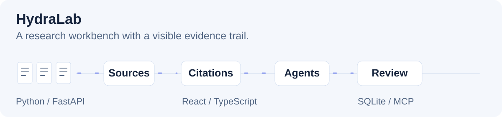

<picture>
  <source media="(prefers-reduced-motion: reduce) and (max-width: 600px) and (prefers-color-scheme: dark)" srcset="./assets/workbench-dark-mobile-still.svg">
  <source media="(prefers-reduced-motion: reduce) and (max-width: 600px)" srcset="./assets/workbench-light-mobile-still.svg">
  <source media="(prefers-reduced-motion: reduce) and (prefers-color-scheme: dark)" srcset="./assets/workbench-dark-still.svg">
  <source media="(prefers-reduced-motion: reduce)" srcset="./assets/workbench-light-still.svg">
  <source media="(max-width: 600px) and (prefers-color-scheme: dark)" srcset="./assets/workbench-dark-mobile.svg">
  <source media="(max-width: 600px)" srcset="./assets/workbench-light-mobile.svg">
  <source media="(prefers-color-scheme: dark)" srcset="./assets/workbench-dark.svg">
  
</picture>

I build AI-assisted applications with **Python and TypeScript**. I'm a BS Computer Science student at **Visayas State University**, Philippines, with expected completion in **July 2027**.

**[Explore my builds](#ai-work)** &nbsp; / &nbsp; **[Open the research notebook](#research-notebook)** &nbsp; / &nbsp; **[Let's work together](#lets-work-together)**

[Still version](./PROFILE-STILL.md) · [LinkedIn](https://www.linkedin.com/in/m1vj/)

## AI work

### [HydraLab](https://github.com/M1Vj/HydraLab) · Research with an evidence trail

<picture>
  <source media="(max-width: 600px) and (prefers-color-scheme: dark)" srcset="./assets/hydralab-dark-mobile.svg">
  <source media="(max-width: 600px)" srcset="./assets/hydralab-light-mobile.svg">
  <source media="(prefers-color-scheme: dark)" srcset="./assets/hydralab-dark.svg">
  
</picture>

I built a local-first workbench for reading, citing, writing and running research-agent workflows. Documents, notes and source locators stay connected, with approval checkpoints and traceable agent runs.

<b>Inspect the build</b> — ingestion, citations, MCP and human review

| Part of the system | What I built |
| :--- | :--- |
| Context | Document ingestion and extractive retrieval with source locators |
| Evidence | Citations connected to the material they came from |
| Agent workflows | MCP tools, traceable runs and human approval checkpoints |
| Application | Python/FastAPI, React/TypeScript, SQLite and a Tauri desktop shell |

[Explore the MIT-licensed source](https://github.com/M1Vj/HydraLab)

### [VSU SmartMap](https://vsumap.vercel.app) · AI that knows its way around campus

A campus navigation PWA with an interactive map, searchable directory and **Gemini-powered location chat**. I now maintain it solo, after its start as a Software Engineering group project.

<b>Inspect the build</b> — location chat, offline access and reviewed suggestions

- Connected Gemini/Genkit to the campus location experience.
- Built offline caching, reviewed user suggestions and admin tools.
- Worked across Next.js, TypeScript, Supabase/PostgreSQL, Leaflet and Dexie, with an Android Trusted Web Activity companion.

[Try the campus map](https://vsumap.vercel.app)

[Explore the source](https://github.com/M1Vj/VSU-SmartMap)

### SangkAI · Human review in a civic-feedback workflow

During my **June–July 2026 AI4GOV internship**, I contributed with Pod B to a civic-feedback prototype for Philippine local-government contexts. My lane covered **AI workflows, prompts, fallback behavior, safety checks and documentation**, alongside implementation, testing and demo preparation. Human staff review AI suggestions before official decisions.

## Research notebook

**What changes in a detector's scores when AI text is watermarked?**

My undergraduate research compares fixed passive AI-text detector scores on paired **watermarked and unwatermarked Gemma responses**. I use Python analysis, paired comparisons and reproducibility checks to understand score behavior.

<b>Open the method notes</b> — embeddings, transformers and the limits of a score

- My earlier proposal explored content/function-word embeddings and persistent homology. The current study focuses on evaluation of transformer-based AI-text detectors.
- Both sides of each comparison are AI-generated text. This comparison does **not** establish authorship or detector accuracy on human writing.
- I care about reproducible analysis and reporting what the evidence supports.

## The software around the AI

**[MathWiz Arena / centipede](https://github.com/M1Vj/centipede)** — Lead developer on a collaborative math competition platform. Problem banks, team competitions, scoring, answer review, disputes, leaderboards and exports, with role-based access and Supabase row-level security.

**[UniDorm](https://github.com/M1Vj/Dormy)** — Solo-built dormitory operations software for resident management, finance, clearance, events, evaluations and spreadsheet imports, with tenant-aware access.

<b>Open my toolbox</b> — tools in the context of the work

| Work | Tools and interests |
| :--- | :--- |
| Applied AI | LLM integration, prompts, AI agents, MCP and human-reviewed workflows |
| Research | Python, embeddings, transformers and NLP evaluation |
| Products | TypeScript, React, Next.js, FastAPI, SQL, PostgreSQL, Supabase and SQLite |
| Verification | Git, Playwright, Vitest, source review and browser checks |

<picture>
  <source media="(max-width: 600px) and (prefers-color-scheme: dark)" srcset="./assets/workflow-dark-mobile.svg">
  <source media="(max-width: 600px)" srcset="./assets/workflow-light-mobile.svg">
  <source media="(prefers-color-scheme: dark)" srcset="./assets/workflow-dark.svg">
  
</picture>

## Let's work together

I'm interested in **early-career applied AI and software development opportunities**: useful products, grounded outputs and reliable systems.

**[Connect on LinkedIn](https://www.linkedin.com/in/m1vj/)** · **[Browse my public repositories](https://github.com/M1Vj?tab=repositories)**
